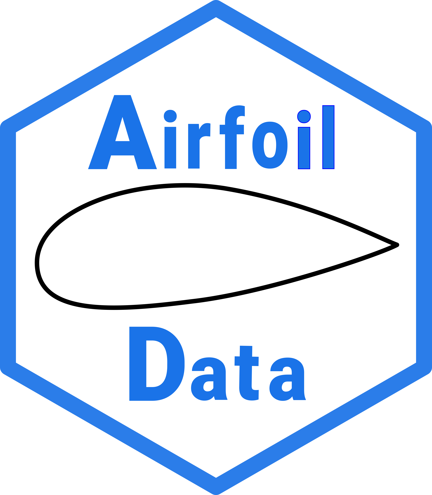

<p align="center">

</p>

<p align="center">
<strong>A C++17 Library for Airfoil Data Storage, Analysis, and Manipulation</strong>
</p>

<p align="center">
<a href="https://github.com/of33/AirfoilData/actions/workflows/build-and-test.yml">

</a>
&nbsp;&nbsp;
<a href="https://doi.org/10.5281/zenodo.20548727"></a>
&nbsp;&nbsp;
<a href="LICENCE">

</a>
</p>

# AirfoilData

**AirfoilData** is a compact C++17 library for storing, validating,
normalizing, redistributing, and analyzing two-dimensional airfoil
coordinates.

It is intended for engineering and scientific applications and provides:

- a straightforward Basic API for ordinary airfoil-processing workflows,
- an Advanced API for individual numerical processing steps,
- an Integration API for external solvers, graphical applications, and
  low-level data exchange,
- a standalone implementation of one-dimensional Akima interpolation.

The implementation emphasizes readable numerical procedures, practical
engineering use, defensive input validation, predictable object state, and
reproducible regression testing.

---

## Design Philosophy

AirfoilData reflects several decades of professional experience with
numerical, aerodynamic, and engineering software.

The principal goals are:

- simple use and integration,
- a small number of core source files,
- no mandatory dependencies beyond the C++ standard library,
- readable and inspectable numerical algorithms,
- explicit units, normalizations, and physical meanings,
- checks for dimensions, point counts, ordering, NaN, and infinity,
- transactional updates where operations can fail,
- extensive regression and developer testing.

The complete core consists of four files:

```text
src/AirfoilData.h
src/AirfoilData.cpp
src/AkimaInterpolation.h
src/AkimaInterpolation.cpp
```

Ordinary applications include:

```cpp
#include "AirfoilData.h"
```

and link the two core object files:

```text
build/AirfoilData.o
build/AkimaInterpolation.o
```

A static-library archive is not required. An optional archive can be generated
for convenience on compatible systems.

---

## Features

### Airfoil Geometry

- storage of complete airfoil contours,
- contour consistency and crossing checks,
- normalization to unit chord and zero incidence,
- support for open and closed trailing edges,
- leading-edge detection by:
  - local chordwise minimum,
  - longest secant from the trailing-edge midpoint,
- redistribution onto cosine-based support-point distributions,
- repair of small chordwise contour reversals,
- separation into upper and lower surfaces.

### Geometric Properties

- maximum thickness and its chordwise location,
- maximum signed camber and its chordwise location,
- trailing-edge thickness,
- cross-sectional area,
- upper-surface nose ordinate at \(x/c=0.0125\),
- camber-line distribution,
- signed half-thickness distribution.

### Derivatives

- first chordwise derivatives,
- second chordwise derivatives,
- separate upper- and lower-surface data,
- bundled access through `GradientData`.

The API retains the historical name *curvature data* for some second-
derivative fields. These values are \(d^2y/dx^2\), not differential-geometric
curvature.

### Thin-Airfoil Geometry Descriptors

- normalized vortex-sheet distribution \(k/U_\infty\),
- fixed reference lift coefficient \(c_l = 0.5\),
- scaled source--sink distribution \(q/(2U_\infty\) = \(dz^\(t\)/\(dx\)
- inviscid geometric zero-lift angle,
- inviscid geometric zero-lift pitching-moment coefficient.

The stored singularity distributions are primarily geometry descriptors for
subsequent airfoil-generation methods. They are not dimensional singularity
strengths or complete viscous-flow solutions.

### Application Integration

- configurable output callback,
- console fallback,
- output suppression,
- diagnostic verbosity levels,
- storage of external aerodynamic coefficient data,
- storage of pressure-coefficient distributions,
- storage of conformal-mapping data,
- low-level setters for specialized integration workflows.

### Numerical Reliability

- finite-value checks,
- vector-dimension checks,
- point-count validation,
- interpolation-grid validation,
- output-aliasing checks,
- transactional state updates,
- standard-library containers and value semantics,
- GCC and Clang regression comparisons,
- sanitizer, coverage, static-analysis, and Valgrind targets.

---

## Requirements

For the core library:

- a C++17-compatible compiler,
- the C++ standard library.

For the supplied build targets and example:

- GNU Make or a compatible `make`,
- `gnuplot` for optional plot generation,
- `git` for cloning and development.

The core library has no mandatory third-party runtime dependency.

### Optional MSYS2 Developer Tools

The core library and example do not require Clang.

For the Clang and clang-tidy developer targets in MSYS2 UCRT64, install:

```bash
pacman -S --needed \
mingw-w64-ucrt-x86_64-clang \
mingw-w64-ucrt-x86_64-clang-tools-extra
```

These packages are not needed for ordinary library use, the core object files,
the optional archive, or the example program.

Depending on the current MSYS2 package set, the corresponding sanitizer
runtime may still be unavailable. The test Makefile detects this and reports
the affected target as `NOT RUN`.

---

## Quick Start

The following example assumes that the airfoil coordinates have already been
read into two `std::vector<double>` objects named `x` and `y`.

```cpp
#include "AirfoilData.h"

#include <iostream>
#include <vector>

int main()
{
    std::vector<double> x;
    std::vector<double> y;

    // Read the airfoil coordinates into x and y.

    AirfoilData airfoil;
    airfoil.setAirfoilName("Example airfoil");

    if (!airfoil.setAirfoilPoints(x, y))
    {
        std::cerr
            << "The coordinate vectors are inconsistent.\n";
            return 1;,
            \]
    }

    if (!airfoil.airfoilOK(TrailingEdgeCheck::Full))
    {
        std::cerr
            << "The airfoil contour is not valid.\n";
        return 1;
    }

    if (!airfoil.calculateAirfoilProperties())
    {
        std::cerr
            << "Could not calculate airfoil properties.\n";
        return 1;
    }

    std::cout << "Thickness: "
              << airfoil.getThickness() << "\n";

    std::cout << "Thickness location: "
              << airfoil.getThicknessLocation() << "\n";

    std::cout << "Camber: "
              << airfoil.getCamber() << "\n";

    std::cout << "Camber location: "
              << airfoil.getCamberLocation() << "\n";

    std::cout << "Area: "
              << airfoil.getArea() << "\n";

    std::cout << "Zero-lift angle: "
              << airfoil.getAlpha0Geo()
              << " deg\n";

    return 0;
}
```

All important status returns should be checked before output parameters or
calculated data are used.

---

## Building the Example

Build the documented example with:

```bash
make
```

or:

```bash
make example
```

The executable is written to:

```text
bin/example
```

On Windows with MSYS2, it is normally:

```text
bin/example.exe
```

Run it on Linux or macOS with:

```bash
./bin/example
```

Run it on Windows with MSYS2 using:

```bash
./bin/example.exe
```

By default, the example reads:

```text
tests/data/NACA2312.dat
```

A different input file can be supplied as the first argument:

```bash
./bin/example path/to/airfoil.dat
```

On Windows:

```bash
./bin/example.exe path/to/airfoil.dat
```

---

## Building the Core Object Files

Build only the two reusable implementation objects with:

```bash
make objects
```

This creates:

```text
build/AirfoilData.o
build/AkimaInterpolation.o
```

Link them directly into an application:

```bash
g++ -std=c++17 -O2 -Wall -Wextra -Isrc \
    main.cpp \
    build/AirfoilData.o \
    build/AkimaInterpolation.o \
    -o main
```

Object files must be built with a toolchain, ABI, architecture, and relevant
compiler options compatible with the application.

---

## Optional Static Archive

On systems providing a compatible `ar` tool, create the optional static
archive with:

```bash
make lib
```

This creates:

```text
lib/libAirfoilData.a
```

Link an application with:

```bash
g++ -std=c++17 -O2 -Wall -Wextra -Isrc \
    main.cpp \
    -Llib -lAirfoilData \
    -o main
```

The static archive is optional. The default example build links the object
files directly.

---

## Example Program

The supplied `example.cpp` performs a complete workflow:

1. reads a NACA 2312 coordinate file,
2. assigns the contour,
3. checks the geometry,
4. calculates the complete property data,
5. demonstrates Akima interpolation on the camber line,
6. calculates normalized vortex-sheet and scaled source--sink distributions,
7. redistributes the contour to 333 points,
8. writes four data files.

Typical output includes:

```text
Geometry:
  Thickness               = 0.1200
  Thickness location      = 0.2998
  Camber                  = 0.0211
  Camber location         = 0.2961
  TE thickness            = 0.0025
  Area                    = 0.0819
  Nose thickness at 1.25% = 0.0199
  alpha0 (inviscid)       = -1.9624
  cm0    (inviscid)       = -0.0454
```

The example writes:

```text
example_airfoil.dat
example_camber.dat
example_circ_source.dat
example_grad_curv.dat
```

---

## Plot Generation

Generate all documented PNG files with:

```bash
make plot
```

This builds and runs the example and then calls:

```bash
gnuplot plot/plot.gnu
```

The generated plots are:

```text
plot/example_airfoil.png
plot/example_camber.png
plot/example_circ_source.png
plot/example_grad_curv.png
```

If `gnuplot` is unavailable, the numerical `.dat` files are still generated.

---

## Akima Interpolation

`AkimaInterpolation` can be used independently of `AirfoilData`.

```cpp
#include "AkimaInterpolation.h"

#include <iostream>
#include <vector>

int main()
{
    std::vector<double> x =
        {0.0, 0.25, 0.5, 0.75, 1.0};

    std::vector<double> y =
        {0.0, 0.05, 0.04, 0.02, 0.0};

    AkimaInterpolation interpolation;

    if (!interpolation.init(x, y))
    {
        std::cerr << "Initialization failed.\n";
        return 1;
    }

    double value = 0.0;
    double firstDerivative = 0.0;
    double secondDerivative = 0.0;

    if (!interpolation.interpolate(
            0.4,
            value,
            firstDerivative,
            secondDerivative))
    {
        std::cerr << "Interpolation failed.\n";
        return 1;
    }

    std::cout << "y       = " << value << "\n";
    std::cout << "dy/dx   = " << firstDerivative << "\n";
    std::cout << "d2y/dx2 = " << secondDerivative << "\n";

    return 0;
}
```

The support-point abscissas must be finite and strictly ascending. At least two
points are required.

Applications using only `AkimaInterpolation` need to link only:

```text
build/AkimaInterpolation.o
```

---

## Tests

Run the standard developer check set with:

```bash
make test
```

A successful run ends with:

```text
TEST OVERALL: PASSED
```

The regression harness includes or requests:

- golden-reference comparison,
- GCC and Clang builds,
- AddressSanitizer,
- UndefinedBehaviorSanitizer,
- implicit-conversion checks,
- libstdc++ debug checks,
- method coverage,
- GCC static analysis,
- `clang-tidy`,
- optional Valgrind checks.

Selected individual targets include:

```bash
make -C tests test-gcc
make -C tests test-clang
make -C tests san-gcc
make -C tests san-clang
make -C tests coverage
make -C tests analyzer
make -C tests tidy
make -C tests memcheck
make -C tests sharp
```

### Floating-Point Comparison

Finite floating-point values are compared with:

```text
abs(golden - actual)
<= 1e-12
+ 1e-9 * max(abs(golden), abs(actual))
```

The values are serialized with the exact hexadecimal `%a` representation
before comparison. The numerical tolerance accommodates small differences
between supported compilers and platforms, including Linux/GCC and
Windows/MSYS2/GCC.

Tags, record structure, dimensions, integer values, Boolean values, diagnostic
text, record order, and the total record count are compared exactly.

The tolerances are not intended to hide algorithmic changes.

### Skipped Optional Checks

Some sanitizer targets require runtime libraries that are not available in
every compiler installation. In that case, the Makefile prints a warning such
as:

```text
WARNING: san-gcc NOT RUN - the address/undefined sanitizer runtime
(libasan/libubsan) is not installed for g++.
```

The remaining checks continue to run.

`TEST OVERALL: PASSED` means that all checks actually executed passed. It does
not mean that every optional sanitizer or analysis target was executed.

Before a release, sanitizer checks should pass on at least one supported
environment where the required runtime libraries are available.

See the User Manual and [`CONTRIBUTING.md`](CONTRIBUTING.md) for details.

---

## Documentation

The full documentation is provided in the AirfoilData User Manual.

It contains:

- installation instructions for Windows, Linux, and macOS,
- design philosophy and coordinate conventions,
- theoretical interpretation of the stored singularity distributions,
- Quick Start instructions,
- example and plotting instructions,
- standalone Akima interpolation documentation,
- Basic, Advanced, and Integration API references,
- build and test-harness documentation,
- contribution guidelines.

Release history is documented in [`CHANGELOG.md`](CHANGELOG.md).

---

## Theoretical Background

The theoretical background of the stored normalized vortex-sheet and scaled
source--sink distributions is described in the companion reports.

### Camber-Line Formulation

> Olaf Frommann
> *Thin Airfoil Theory (Camber-Line Formulation) — Deep Documentation of a
> Teaching C++ Implementation*
> Version 1.1.0, 2026
> DOI: [10.5281/zenodo.18422228](https://doi.org/10.5281/zenodo.18422228)
> Repository: <https://github.com/of33/TAT>

### Thickness Formulation

> Olaf Frommann
> *Thin Airfoil Theory (Thickness Formulation) — Deep Documentation of a
> Teaching C++ Implementation*
> Version 1.0.0, 2026
> DOI: [10.5281/zenodo.19546291](https://doi.org/10.5281/zenodo.19546291)
> Repository: <https://github.com/of33/TATT>

---

## Repository Contents

For ordinary use, download a numbered release from:

<https://github.com/of33/AirfoilData/releases>

For reproducible engineering or scientific work, use a specific release
version rather than the current development branch.

Typical repository contents are:

```text
src/
    AirfoilData.h
    AirfoilData.cpp
    AkimaInterpolation.h
    AkimaInterpolation.cpp

tests/
    Makefile
    data/
    src/

plot/
    plot.gnu

example.cpp
Makefile
AirfoilDataLogo.png
AirfoilData_UserManual.pdf
CITATION.cff
CHANGELOG.md
CONTRIBUTING.md
LICENCE
GPLv3
README.md
```

Generated build products include:

```text
build/    core object files
bin/      example executable
lib/      optional static archive
plot/     generated PNG files
```

---

## License

AirfoilData is distributed under the **GNU General Public License, version 3
or later**, with the additional attribution terms stated in `LICENCE`.

See:

```text
LICENCE
GPLv3
```

for the complete terms.

Redistributions and derivative works must retain the required attribution
notice described in `LICENCE`.

Because the project includes additional attribution terms, users should refer
to the complete license text rather than relying only on a short SPDX-style
identifier.

---

## How to Cite

Citation metadata are provided in:

```text
CITATION.cff
```

For exact reproducibility, cite the version-specific release and DOI listed on
the corresponding GitHub or Zenodo release page.

```bibtex
@software{frommann2026airfoildata,
    author  = {Frommann, Olaf},
    title   = {AirfoilData - A C++ Library for Airfoil Data Storage, Analysis and Manipulation},
    year    = {2026},
    version = {1.0.0},
    url     = {https://github.com/of33/AirfoilData}
    license      = {GPL-3.0-or-later},
    doi          = {10.5281/zenodo.20548727}

}
```

The theoretical reports listed above should additionally be cited when the
normalized vortex-sheet or scaled source--sink formulations are used.

---

## Version Information

AirfoilData is currently documented as version **1.0.0**.

The version can be queried in C++:

```cpp
std::cout << AirfoilData::versionString() << "\n";
```

Individual components are available through:

```cpp
AirfoilData::versionMajor();
AirfoilData::versionMinor();
AirfoilData::versionPatch();
AirfoilData::versionString();
```

Future changes are documented in [`CHANGELOG.md`](CHANGELOG.md).

---

## Contributing

Bug reports, questions, and pull requests are welcome.

Please read [`CONTRIBUTING.md`](CONTRIBUTING.md) before submitting a larger
change or modifying numerical behavior.

---

## Contact

For questions, suggestions, or bug reports, use the GitHub issue tracker:

<https://github.com/of33/AirfoilData/issues>

